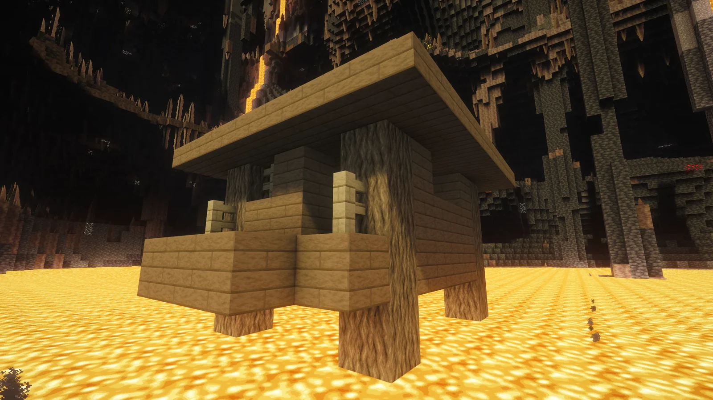

# LowYSwampHut · WebAssembly Web Edition

[简体中文](README.zh-CN.md) | [English](README.en.md) | **Bilingual overview / 双语对比**

A static WebAssembly page for searching **low-Y witch huts in Minecraft Java Edition**.
It uses the C core from [`LowYSwampHut`](../LowYSwampHut) (`LowYSwampHutFinderBase`), compiled
with Emscripten. There is no backend: seeds, ranges and results stay in the browser.

在浏览器里搜索 **Minecraft Java 版低 Y 坐标女巫小屋**。计算内核来自原项目
[`LowYSwampHut`](../LowYSwampHut) 的 C 代码（`LowYSwampHutFinderBase`），通过 Emscripten
编译成 WebAssembly。页面没有后端：种子、范围和结果都只存在于你的浏览器里。

> Every seed has a dream of a low-Y swamp hut. / 每一个种子，都有一个低 y 女巫小屋的梦想。
> — SunnySlopes

---

## At a glance / 一览

| Topic / 项目 | 中文 | English |
|---|---|---|
| What it is / 定位 | Minecraft Java 版低 Y 女巫小屋的浏览器搜索页，计算完全在本地 WASM 中完成 | Browser-based low-Y witch hut search for Minecraft Java Edition; all computation runs in local WASM |
| Run / 运行 | 双击 `index.html` 可单线程运行；用 `ClickMe.bat` / `ClickMe.sh` 通过 HTTP 打开可多线程并自动打开浏览器 | Double-click `index.html` for single-thread; use `ClickMe.bat` / `ClickMe.sh` over HTTP for multi-thread and auto-open |
| Threads / 线程 | 检测成功时默认本机最大线程数，可手动调整；桌面最多 32、移动端最多 4；约 64MB/Worker | Uses the local maximum thread count by default when detected, adjustable; up to 32 desktop / 4 mobile; ~64 MB per Worker |
| Search modes / 模式 | 单种子搜索；种子列表搜索（`txt`，每行一个种子） | Single seed; seed list (`txt`, one seed per line) |
| Defaults / 默认范围 | 单种子：世界边界；种子列表：256 | Single seed: world border; seed list: 256 |
| Performance / 性能 | 12 Worker 约 36–40M 区域/秒；全图 HTTP 约 6 分钟，`file://` 单线程约 30 分钟（本机实测） | ~36–40M regions/sec with 12 Workers; full world ~6 min over HTTP, ~30 min with one `file://` thread (measured locally) |
| Mobile / 移动端 | `mobile.html` 竖屏精简版，保留搜索控制台、线程数调整与结果区 | `mobile.html` reduced portrait edition; keeps the search console, thread control and results |
| Build / 构建 | Emscripten；`wasm/build.ps1` 或 `wasm/build.sh` | Emscripten; `wasm/build.ps1` or `wasm/build.sh` |
| License / 许可证 | MIT，见 `LICENSE` | MIT, see `LICENSE` |

## Preview / 预览



A local search console for low-Y witch huts. See the full documentation for features and UI details.
低 Y 女巫小屋的本地搜索控制台；完整功能与界面说明见下方完整文档。

## Quick start / 快速开始

### Windows

```powershell
# Double-click ClickMe.bat, or run the PowerShell script directly:
powershell -ExecutionPolicy Bypass -File serve.ps1

# Start the server only, without opening a browser:
powershell -ExecutionPolicy Bypass -File serve.ps1 -NoOpen
```

### macOS / Linux

```bash
# Multi-threaded, opens the browser when ready
chmod +x ClickMe.sh
./ClickMe.sh

# Do not open a browser
NO_OPEN=1 ./ClickMe.sh
```

`file://` works for a single-threaded run; Workers and multi-threading require HTTP/HTTPS.

`file://` 可单线程运行；Worker 和多线程需要 HTTP/HTTPS。

## Performance snapshot / 性能速览

| Configuration / 方案 | Regions/sec / 区域每秒 | Notes / 说明 |
|---|---:|---|
| Native C CLI, single thread / 原生单线程 | ~5.2M | AVX2 + LTO |
| WASM, single thread / WASM 单线程 | ~7.5M | Comparable / 与原生单核相当 |
| Native C, 32 threads / 原生 32 线程 | ~71M | 32 logical cores / 32 逻辑核 |
| WASM, 12 Workers (HTTP) | ~36–40M | Measured config / 实测配置 |

The page defaults to the local maximum thread count and lets you adjust it; the 12-Worker row
above is the measured configuration.

页面默认使用本机最大线程数，并允许手动调整；上表的 12 Worker 是实测配置。

## Repositories / 仓库

- **Original Java edition / 原 Java 版库** — [M33Galaxy/LowYSwampHut](https://github.com/M33Galaxy/LowYSwampHut)
- **Base library / 基底库** — [M33Galaxy/LowYSwampHutFinderBase](https://github.com/M33Galaxy/LowYSwampHutFinderBase)
- **Web edition / 网页版库** — [SunnySlopes/LowYSwampHutWeb](https://github.com/SunnySlopes/LowYSwampHutWeb)

> Online search too slow or running into problems? Download the web edition and run it locally for a fast search.
>
> 在线搜索过慢或遇到问题？请下载该库本地启动进行快速搜索。

## Full documentation / 完整文档

- [完整中文说明](README.zh-CN.md)
- [Full English documentation](README.en.md)

---

## License / 许可证

Released under the **MIT License** — see [LICENSE](LICENSE).
本项目以 **MIT License** 发布，完整文本见 [LICENSE](LICENSE)。
